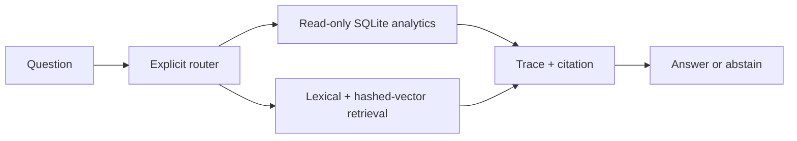

# Operations Evidence Analyst

This project is a small deterministic operations-analysis path extracted from an earlier research prototype. It demonstrates bounded read-only SQL, rule-based routing, deterministic retrieval, citations, and an inspectable tool trace over synthetic operations data.



## Run locally

```bash
python3 -m pytest -q tests
PYTHONPATH=. python3 evaluation/run_evaluation.py
```

The evaluation is offline and reproducible. It currently contains 21 fixture-regression cases over a 20-row CSV in `air_ops/data/operations.csv`. The data is not an airline feed, and a full pass means only that the checked-in deterministic rules still satisfy these checked-in cases.

## Execution scope

The project runs locally and offline only; it has no public deployment. A full local run is a 21/21 deterministic fixture-regression pass, not an accuracy result or a live-service result.

## What is demonstrated

- SQL is restricted to one bounded `SELECT`, `WITH`, or `EXPLAIN` statement against an in-memory copy of the fixture.
- Retrieval returns evidence IDs and citations; retrieved text is treated as untrusted data, including the prompt-injection fixture.
- The route and each tool call are returned in a JSON trace.
- Unsupported, live, or instruction-bypassing requests abstain.

## System scope

- Routing is a regex/keyword policy, not a learned classifier or LLM router.
- Query selection chooses among three hard-coded SQL templates; it is not general text-to-SQL.
- Retrieval ranks a six-item checked-in corpus with token overlap and a 64-bin hashed bag-of-words vector; it is not a quality-validated embedding benchmark.
- Answers format returned rows or fixture text; they do not perform generative analytical synthesis or evidence-entailment checking.
- Each evaluation case checks only the expected route and one required answer substring. The cases were designed around the same bounded feature set, so the result is a regression-fixture pass, not model accuracy.

The original FastAPI/React application remains in `backend/` and `frontend/` as the prototype surface. Its optional LLM, web-search, and PDF ingestion integrations require separately configured providers and are not used by the deterministic evaluation.

## Limitations

This is a small local engineering example, not a benchmark, full analytics system, financial adviser, airline operations system, or hosted production service. It does not establish SQL-generation quality, retrieval quality, citation entailment, model accuracy, operational readiness, or performance on live data. No current-data, privacy, latency, or provider-isolation guarantee is implied.
